# CTS — User Manual

Correspondence Tracking System, Ministry of Interior, Directorate of Civil Status.
Screenshots are in `docs/screens/manual/`.

## 1. What the system is for

CTS records every piece of civil-registry correspondence (incoming and outgoing), moves it through a defined review process, and keeps a permanent record of who did what and when. Each item is a **request** with a reference number such as `CTS-2026-000123`.

## 2. Signing in

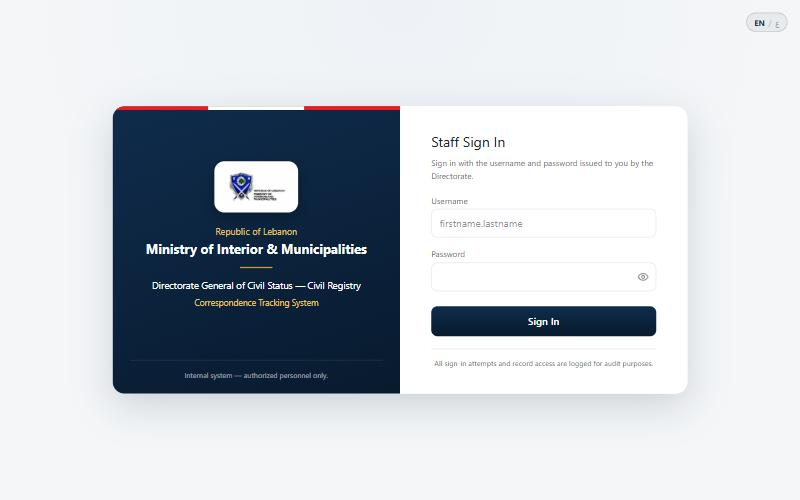

1. Open the system address given by your administrator.
2. Enter your username and password and press **Sign In**.
3. Five wrong passwords lock the account for 15 minutes. Contact an administrator if you forget your password.
4. The **EN** button (top right) switches between English and Arabic; Arabic switches the page to right-to-left. Your choice is remembered.
5. Use the avatar menu at the top right to sign out. Sign out when you leave a shared computer.

## 3. Roles: what each person can do

| Capability | Viewer | Officer | Manager | Administrator |
|---|:-:|:-:|:-:|:-:|
| See dashboard, requests, citizens, workflow | ✔ | ✔ | ✔ | ✔ |
| Create a request and submit it | — | ✔ | — | ✔ |
| Start review, approve or reject | — | — | ✔ | ✔ |
| Archive an approved or rejected request | — | ✔ | — | ✔ |
| Assign or reassign a request, upload documents | — | ✔ | ✔ | ✔ |
| Register and edit citizens | — | ✔ | ✔ | ✔ |
| Record a payment | — | ✔ | ✔ | ✔ |
| Reverse a payment | — | — | ✔ | ✔ |
| Reports | — | — | ✔ | ✔ |
| Users and roles, global audit log | — | — | — | ✔ |

The menu only shows pages you may open.

| Viewer | Officer |
|---|---|
| 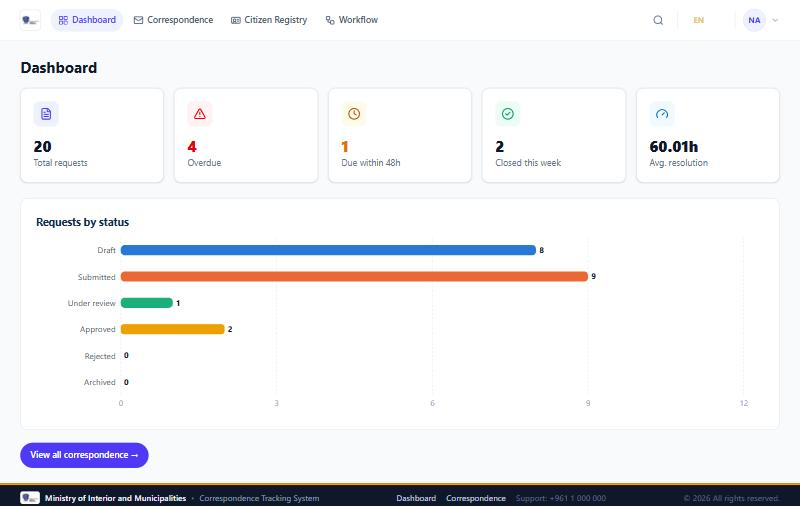 | 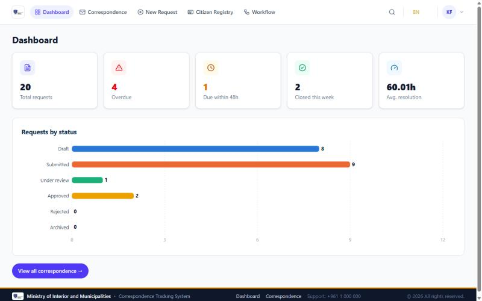 |

| Manager | Administrator |
|---|---|
|  | 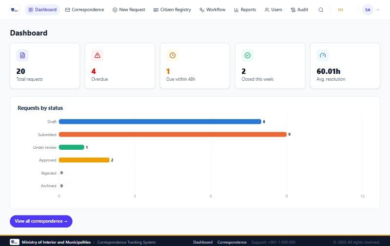 |

## 4. Dashboard

The first page after signing in shows five figures: total requests, **overdue**, due within 48 hours, closed this week, and average resolution time. The bar chart counts requests by status. **View all correspondence** opens the full list.

## 5. Finding requests

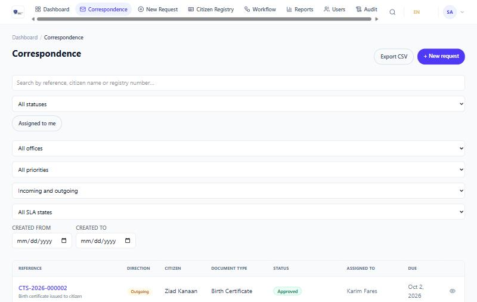

Open **Correspondence**. Type in the search box to find a request by reference, subject, citizen name or registry number. Narrow the list with the drop-downs: status, office, priority, incoming or outgoing, and SLA state (on track, due soon, overdue), plus a created-from and created-to date. **Assigned to me** shows only your own work.

**Export CSV** downloads exactly what the list currently shows, including your filters, for use in Excel.

The badge beside the status shows the deadline state. A request that is past its due date and not yet closed is marked **Overdue**.

## 6. Creating a request (Officer, Administrator)

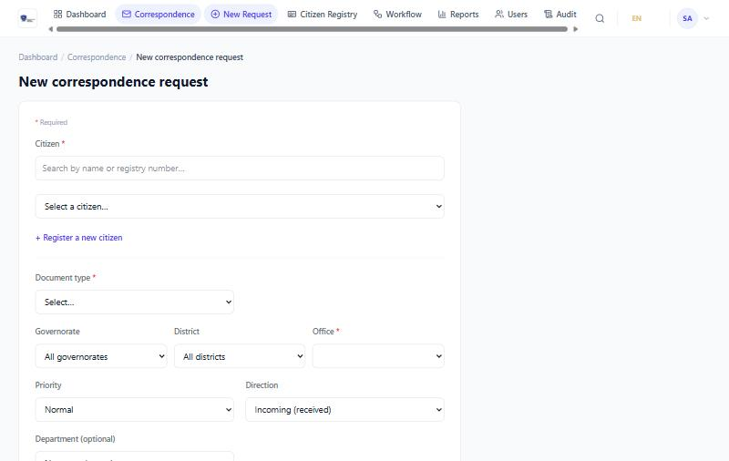

1. Choose **New Request** in the menu.
2. Find the citizen by name or registry number. If the citizen is not registered, choose **Register a new citizen** (see section 9).
3. Choose the document type and the office. Governorate and district help narrow the office list.
4. Set the priority and the direction (incoming or outgoing). The department is optional.
5. Enter a subject and any notes, then press **Create request**.

The request opens as a **Draft** with a reference number and a due date calculated from the document type. Fields marked * are required.

## 7. Working a request

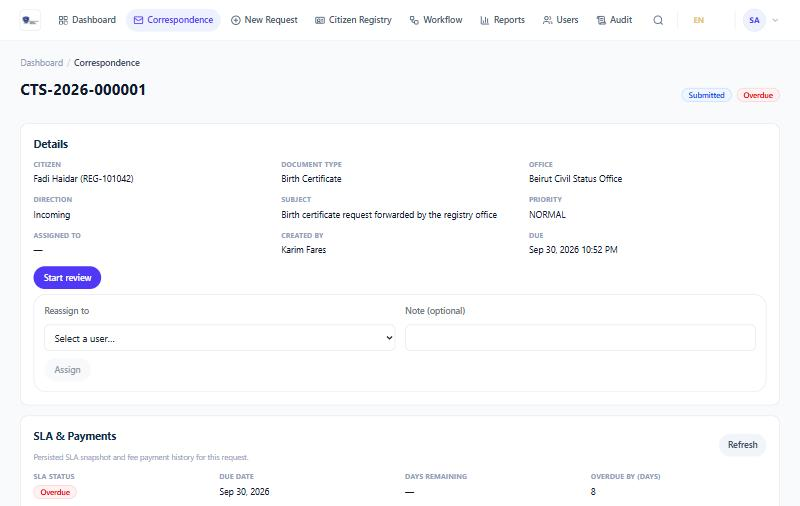

The detail page shows the citizen, document type, office, direction, subject, priority, assignee, creator and due date. Buttons for the next step appear only if your role allows them.

**The life of a request**

```
Draft -> Submitted -> Under review -> Approved  -> Archived
                                   -> Rejected  -> Archived
```

| Step | Who | Notes |
|---|---|---|
| Submit | Officer | Moves a draft into the queue |
| Start review | Manager | Takes the request under review |
| Approve or Reject | Manager | **A rejection requires a written reason** |
| Archive | Officer | Closes an approved or rejected request |

**Assigning.** Under *Reassign to*, pick a staff member, add an optional note and press **Assign**. Each assignment is kept in *Assignment history*, newest first, and only one person is the current assignee. Approved, rejected and archived requests cannot be reassigned.

**SLA and payments.** The *SLA & Payments* panel shows the due date, days remaining or days overdue, and any fee payments. Use **Record payment** to log a fee.

**Documents.** Under *Documents*, press **Upload document** and choose a file. Allowed types are pdf, png, jpg, jpeg, gif, txt, csv, doc, docx, xls and xlsx, up to 15 MB. Other types, such as programs and scripts, are refused. Each file shows a SHA-256 fingerprint so any later change to the file can be detected.

**History.** *Audit trail* lists every status change with the person, time and comment. *Activity log* lists everything else (assignments, uploads, creation). These records cannot be edited or deleted.

## 8. Reports (Manager, Administrator)

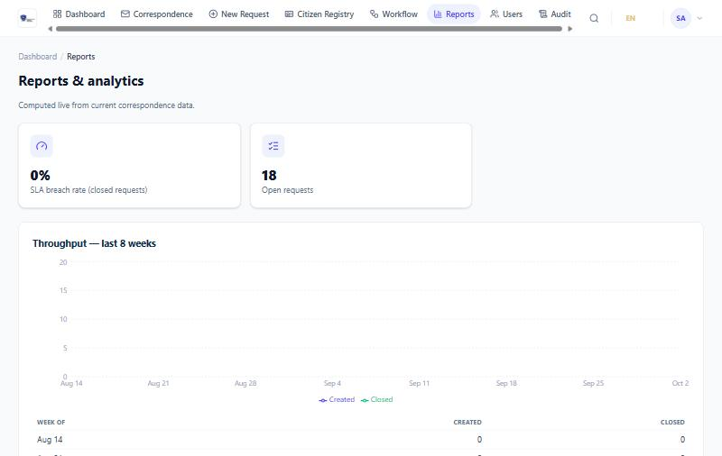

**Reports** shows the SLA breach rate for closed requests, the number of open requests, weekly throughput (created and closed) for the last 8 weeks, the age of open requests, totals and average resolution time by document type, and totals and overdue counts by office. The figures are computed live from current data.

## 9. Citizen registry

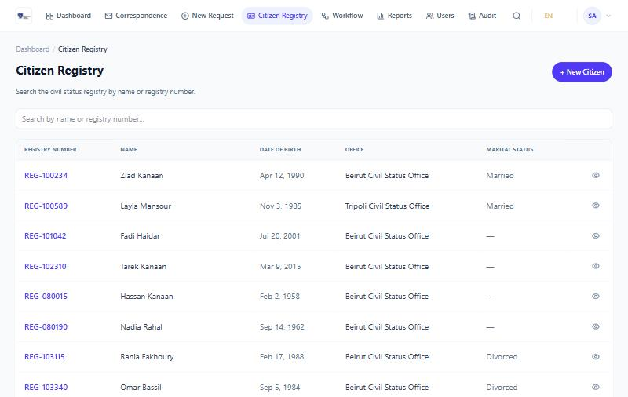

**Citizen Registry** lists registered citizens; search by name or registry number. Select a citizen to open their record. Officers, managers and administrators can register a new citizen with **+ New Citizen**. Every change to a citizen's data is recorded with the old and new value.

## 10. Workflow catalog

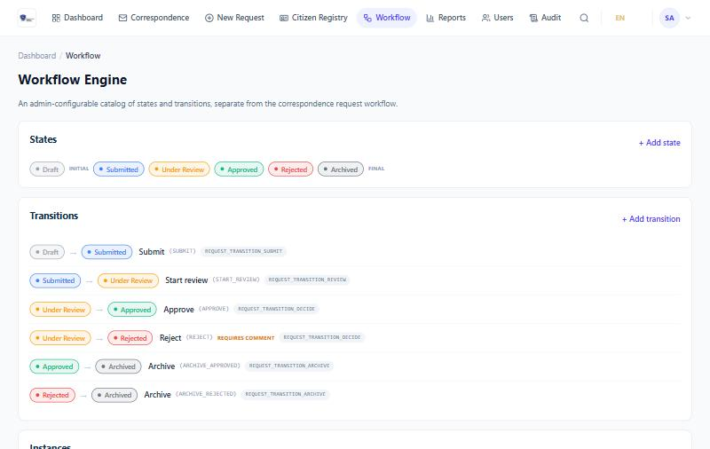

**Workflow** shows the states a request can be in and the allowed moves between them, each with the permission it requires. Everyone can read it. Administrators can adjust which moves are legal and who may make them.

## 11. Administrator functions

**Users and roles**

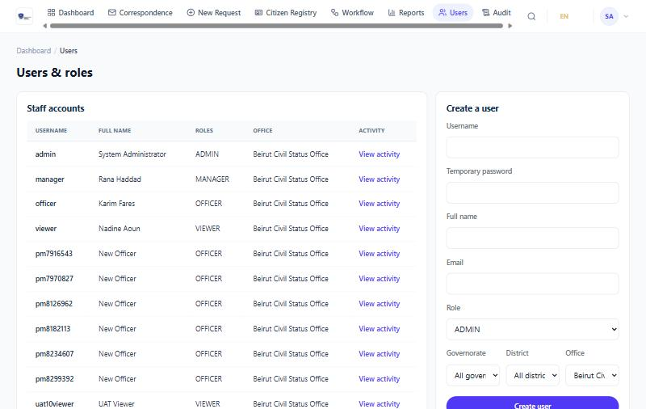

Open **Users** to see all staff accounts. To add someone, fill in username, temporary password, full name, email, role and office on the right, then press **Create user**. Give the temporary password to the person privately. **View activity** shows what a given user has done. After you change a user's role, ask them to sign out and sign in again.

**Global audit log**

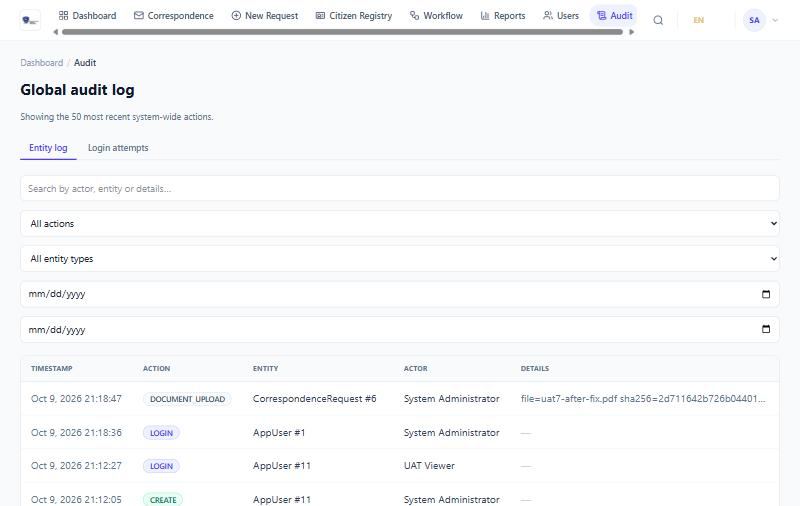

Open **Audit** for the latest system-wide actions: who, what, on which record and when. Search or filter by action, entity type and date. The **Login attempts** tab lists successful and failed sign-ins.

## 12. Arabic interface

Press **EN** at the top to switch to Arabic. All labels are translated and the layout flips to right-to-left.

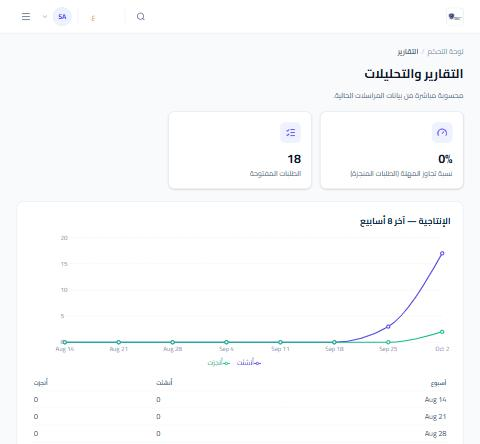

## 13. Frequently asked questions

| Question | Answer |
|---|---|
| I cannot see the *New Request* button. | Your role is read-only (Viewer). Ask an administrator. |
| The upload was refused. | The file type is not allowed or the file is over 15 MB. |
| I cannot reject a request. | A reason is required; type it in the comment box. |
| I cannot assign an approved request. | Closed requests cannot be reassigned. |
| My new permissions do not show. | Sign out and sign in again. |
| I was locked out. | Wait 15 minutes or ask an administrator. |
